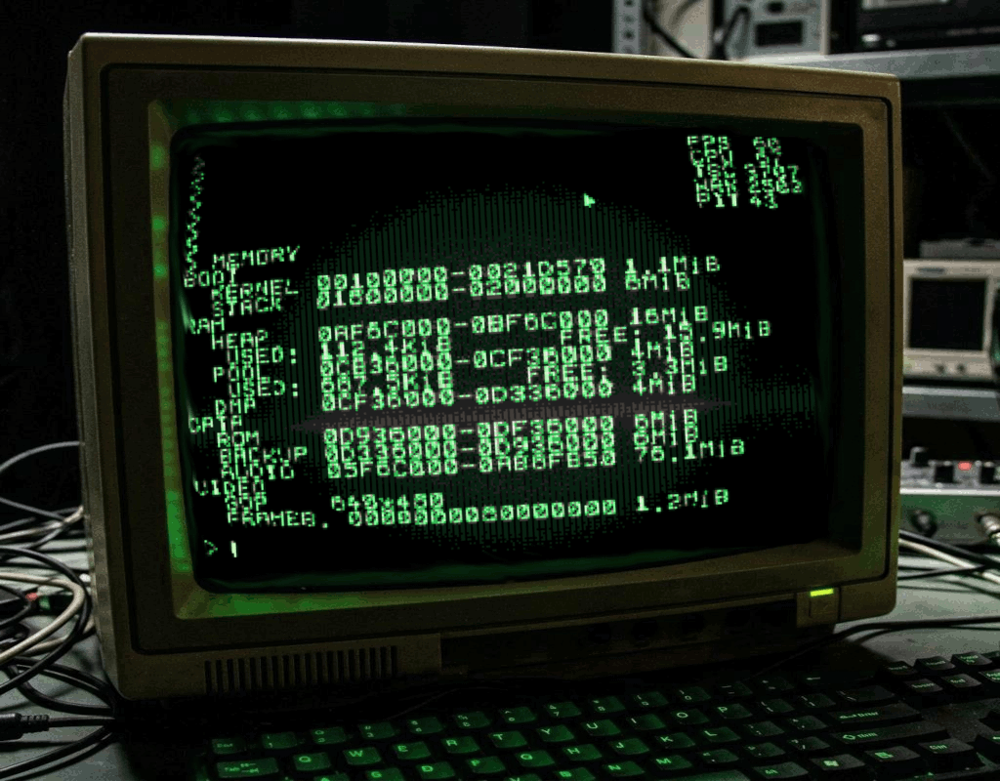

# ⛧ ArChanum

### `TrueArChanum` · Noob Kernel Developer · F-Tier Game Developer

**And most important: I use Arch Linux, btw.**

*I make stuff that probably didn't need to be reinvented...*

Welcome to my GitHub corner!

---

## 💾 Featured projects

  

### ⛧ Penetrizzel

A retro-inspired 32-bit x86 toy operating system.

`Legacy BIOS` · `UEFI` · `Freestanding C99` · `NASM` · `Custom PNO format`

[**Explore Penetrizzel →**](https://github.com/TrueArChanum/Penetrizzel)

### 🤡 Clown.pno

ClownMDEmu packaged as a "Penetrizzel native object".

Special Thanks to **Clownacy** for the marvelous emulator!

[**Explore Clown.pno →**](https://github.com/TrueArChanum/Clown.pno)

### 🪱 Hyperwurm

Remake of the original **Commodore PET Hyper-Wurm (1981) (Von Thomask)** and **TRS-80 Hyper-Wurm (1979) (F. Seger)**.

[**Get Hyperwurm is back! on Steam →**](https://store.steampowered.com/app/4664970/Hyperwurm_is_back/)

### ♟️ Twilight_Chess

Chess with "Shining Force like" Units.

Special Thanks to **nene** for the wonderful music!

Music source: [OpenGameArt – nene](https://opengameart.org/users/nene)

Assets under the CC0 1.0 or CC BY 3.0 licenses:

- Beautiful Forest [Orchestra]             > `beautiful_forest`
- True Love [Epic Orchestral]              > `true_love`
- Night of the Streets [Horror/Suspense]   > `night_of_the_streets`

---

## 🪱 If u want to support my work:

### [🪱 Get "Hyperwurm is back!" on Steam!](https://store.steampowered.com/app/4664970/Hyperwurm_is_back/)

Buying a copy and sharing ur high score would mean a lot!

---

## 💭 Thanks for visiting!

Built with C, Assembly, Arch Linux, questionable decisions, and a little help from ChatGPT.
